  <a href="https://github.com/randheer-rk/gate"><b>gate</b></a> ·
  <a href="https://github.com/randheer-rk/torchit"><b>torchit</b></a> ·
  <a href="https://github.com/randheer-rk/slidesjs"><b>slidesjs</b></a> ·
  <a href="https://linkedin.com/in/randheerrrk">LinkedIn</a> ·
  <a href="https://twitter.com/randheerrrk">X</a>
   Locked items unlock when they are ready.

